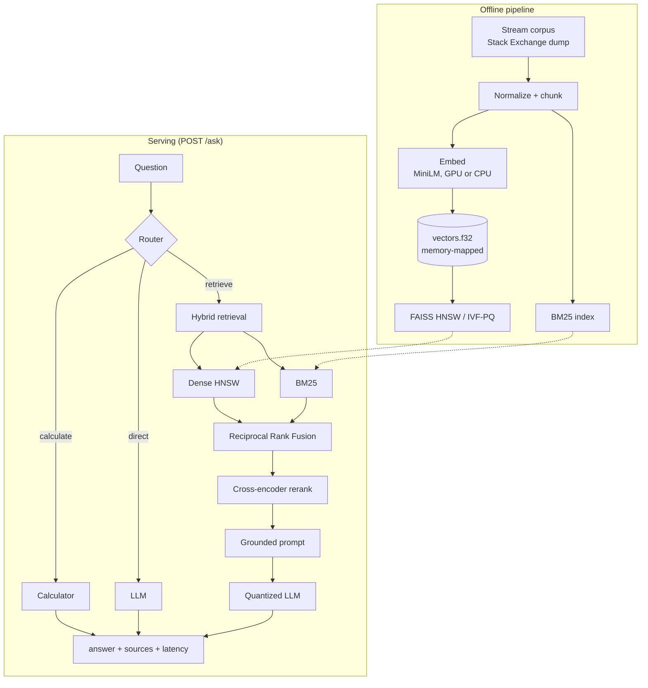

# Efficient RAG

[](https://github.com/mounikakarasu/efficient-rag/actions/workflows/ci.yml)

A Retrieval-Augmented Generation assistant that answers questions over a large
document corpus using a quantized small language model, hybrid retrieval, and a
cross-encoder reranker. It runs on a laptop: it uses a GPU when one is present and
falls back to CPU when it is not, and the full serving stack fits inside a 2 vCPU /
4 GB budget.

## What

- Streams and indexes a large corpus (demonstrated on 20,000 Stack Overflow
  question threads, 150,093 chunks) without loading it all into memory.
- Retrieves with a hybrid of dense vector search (FAISS HNSW), sparse BM25, and
  Reciprocal Rank Fusion, then reranks the candidates with a cross-encoder.
- Generates grounded answers with a 4-bit quantized Qwen2.5-1.5B model via
  llama.cpp, returning the answer, its source passages, and the latency.
- Routes each query to one of three intents: retrieve-and-answer, calculate, or
  direct-answer.
- Serves over HTTP with token streaming and a semantic cache, and ships as a
  resource-limited Docker container.
- Reports measured numbers for every stage: embedding throughput, ANN recall vs
  latency vs memory, retrieval quality, answer quality, and serving throughput.

## Why

This extends the efficiency work in my IEEE paper *Lean Fine-Tuning on a Budget*,
which measured parameter-efficient training under a fixed GPU budget, from training
to inference. The goal is a retrieval system that scales to a large corpus while
staying cheap enough to run on modest hardware, with real measurements instead of
estimates.

## Architecture



## Results

All figures measured on an Intel i7-1255U (10 cores), 16 GB RAM, NVIDIA MX550
(2 GB), Windows 11, Python 3.11.6. Corpus: 20,000 Stack Overflow threads →
150,093 chunks (384-dim).

### Embedding throughput

| Device | Backend | Throughput |
|---|---|---|
| GPU (MX550) | torch, batch 128 | 104 chunks/s (burst), 74 sustained |
| CPU | torch / ONNX | 27 / 29 chunks/s |

ONNX gave no meaningful gain over torch on this CPU and int8 was slower, because
MiniLM is small enough that the CPU is already the limit. The GPU path is ~3x
faster sustained.

### Vector index (recall@10 vs exact search, 200 queries)

| Index | recall@10 | p50 latency | Index size |
|---|---|---|---|
| Flat (exact) | 1.000 | 13.4 ms | 230 MB |
| HNSW | 0.988 | 0.35 ms | 271 MB |
| IVF-PQ | 0.646 | 0.27 ms | 12 MB |

HNSW gives near-exact recall at 38x lower latency. IVF-PQ compresses the index 19x
(230 MB to 12 MB) but caps recall around 0.65; raising `nprobe` from 4 to 64 only
moved recall 0.57 to 0.66, so the limit is the product-quantization compression,
not the search breadth.

### Retrieval quality (recall@10 vs labeled answers, 200 queries)

| Method | recall@10 | p50 latency |
|---|---|---|
| Dense (HNSW) | 0.80 | 6 ms |
| Hybrid (BM25 + dense + RRF) | 0.98 | 1031 ms |
| Hybrid + cross-encoder rerank | 1.00 | 1829 ms |

Adding BM25 catches the queries where exact keyword and identifier matches matter,
which are common in technical questions. The hybrid path is slower because the
`rank_bm25` scorer is O(N) per query; a production deployment would use an
inverted-index BM25 service for sub-millisecond sparse retrieval.

### End-to-end evaluation (offline, no external judge)

Retrieval (hybrid + rerank, 100 queries): recall@10, MRR, and nDCG@10 are all 1.00.

Generation (20 queries): faithfulness proxy (answer vs retrieved context) 0.71;
answer embedding similarity to the reference 0.50; token-F1 0.24; ROUGE-L 0.17.
The low lexical scores reflect that a concise 1.5B answer is compared against a
long human accepted answer; the faithfulness proxy being higher than the
reference similarity shows the model grounds its answer in the retrieved context.

### Serving

| Deployment | Throughput | p99 | Notes |
|---|---|---|---|
| Local (GPU-assisted embed) | 75.8 req/s | 238 ms | semantic cache, 100% hit |
| Container (2 vCPU / 4 GB, CPU) | 31.1 req/s | 420 ms | peak memory 3.67 GB |

The full hybrid stack fits inside 2 vCPU / 4 GB. The ~100 ms latency floor is the
query-embedding cost of the semantic cache lookup.

### FAISS vs Qdrant (150,093 vectors, recall@10 vs exact)

| Backend | recall@10 | p50 latency | p95 latency |
|---|---|---|---|
| FAISS HNSW (in-process) | 0.988 | 0.38 ms | 1.29 ms |
| Qdrant HNSW (service) | 0.999 | 18.0 ms | 35.7 ms |

FAISS runs in-process and is far faster per query. Qdrant runs as a service and
returns slightly better recall, adds payload filtering (a filtered search by
`doc_id` returns only that document's chunks, which FAISS cannot do natively),
persistence, concurrency, and built-in quantization, at the cost of a network
round-trip. FAISS suits the single-node edge deployment; Qdrant suits a shared,
filterable, horizontally scaled one.

## How

### Install (CPU, Python 3.11)

```bash
py -3.11 -m venv .venv
.venv\Scripts\activate

pip install torch==2.12.1 --index-url https://download.pytorch.org/whl/cpu
set CMAKE_ARGS=-DGGML_NATIVE=OFF -DGGML_AVX=ON -DGGML_AVX2=ON -DGGML_FMA=ON -DGGML_AVX512=OFF
pip install --no-binary llama-cpp-python "llama-cpp-python==0.3.30"
pip install -r requirements.txt
```

`llama-cpp-python` is built from source because prebuilt wheels assume AVX-512 and
crash on CPUs without it.

### Optional GPU acceleration

Install the CUDA build of PyTorch matching your driver. On the MX550 (driver
CUDA 13.2):

```bash
pip install torch==2.12.1+cu130 --index-url https://download.pytorch.org/whl/cu130
```

The embedder auto-detects CUDA (`EMBEDDING_DEVICE=auto`) and falls back to CPU.

### Build the corpus and indexes

```bash
python -m app.corpus --size 20000        # stream and normalize the corpus
python -m app.embed_corpus               # embed to vectors.f32 (resumable)
python -m app.build_index                # build the serving HNSW index
python -m app.sparse                     # build the BM25 index
python -m bench.build_eval --size 200    # build a labeled eval set
```

To use Qdrant instead of in-process FAISS, run the service and upload the vectors,
then set the backend:

```bash
docker run -d -p 6333:6333 qdrant/qdrant:v1.19.1
python -m app.build_qdrant
set VECTOR_BACKEND=qdrant
```

### Serve

```bash
python -m app.model_download
uvicorn app.main:app --port 8000

curl -X POST http://localhost:8000/ask \
  -H "Content-Type: application/json" \
  -d '{"question": "How do I read a file line by line in Python?"}'
```

Streaming endpoint (Server-Sent Events):

```bash
curl -N -X POST http://localhost:8000/ask/stream \
  -H "Content-Type: application/json" \
  -d '{"question": "How do I reverse a string in Java?"}'
```

### Docker

```bash
docker-compose up --build
```

The container serves on port 8000 under a 2 vCPU / 4 GB limit, using the corpus,
model, and indexes mounted from the host.

### Small local-document mode

For a handful of local files instead of a streamed corpus, point the ingest step
at a folder of PDF, markdown, or text files:

```bash
python -m app.ingest --src ./data
```

### Test and benchmark

```bash
pytest -m "not slow"                # fast suite
pytest                              # full suite (loads the model)

python -m bench.ann_benchmark       # index recall / latency / memory
python -m bench.retrieval_eval      # dense vs hybrid vs rerank recall
python -m bench.rag_eval            # end-to-end retrieval + answer quality
python -m bench.load_test           # serving throughput and latency
```

## Secure mode

A concrete deployment scenario: a team runs the assistant over private documents
that must not leave their environment. Three controls back this up.

- **Offline / no data egress.** With `OFFLINE_MODE=1` the process loads models only
  from the local cache and makes no outbound calls. An egress guard
  (`app/offline.py`) blocks any non-loopback socket connection, so the query path
  can be proven to make zero external calls. This is the difference from sending
  documents and questions to a hosted LLM API.
- **Access-controlled retrieval.** `POST /ask` takes a signed JWT
  (`Authorization: Bearer ...`) whose `sub` and `groups` claims are verified against
  `JWT_SECRET`; the identity is built from the verified claims, not a spoofable
  header. With `AUTH_REQUIRED=1` a valid token is mandatory (401 otherwise).
  `SecureRetriever` then drops any chunk the principal is not permitted to see, so a
  user only gets answers grounded in documents they are allowed to read. The shared
  semantic cache is bypassed for authorized requests so one user's answer is never
  served to another group. With Qdrant the same rule is a payload filter applied
  inside the search. (Unsigned `X-User-Groups` headers are honored only when
  `AUTH_REQUIRED` is off, for local development.)
- **PII / secret redaction.** `app/redaction.py` masks emails, phone numbers,
  SSNs, card numbers, IPs, API keys, and tokens. With `REDACT_LOGS=1` the
  structured logs are redacted, so sensitive content never persists in logs.

Run the demonstration:

```bash
set OFFLINE_MODE=1
python -m bench.secure_demo
```

It shows retrieval running under the egress guard with no external connections,
redaction of a sample containing an email/SSN/key, and per-tenant retrieval where
each group sees only its own documents.

## Configuration

Settings live in [app/config.py](app/config.py) and are overridable by environment
variable: `EMBEDDING_DEVICE` (auto/cpu/cuda), `EMBEDDING_BACKEND` (torch/onnx),
`ANN_INDEX_TYPE` (hnsw/ivfpq/flat), `HYBRID_ENABLED`, `RERANK_ENABLED`,
`RERANKER_MODEL`, `CHUNK_SIZE`, `CHUNK_OVERLAP`, `TOP_K`, `ROUTER_BACKEND`
(plain/langgraph), `CACHE_ENABLED`, `LLM_REPO_ID`, `LLM_FILENAME`,
`VECTOR_BACKEND` (faiss/qdrant), `QDRANT_URL`, `OFFLINE_MODE`, `REDACT_LOGS`.

## Notes

- Energy and CO2 in the single-corpus benchmark are CodeCarbon estimates, since
  Intel RAPL power readings need Linux; the harness switches to measured energy on
  hardware that exposes it.
- The hybrid latency is dominated by the in-memory BM25 scorer, which scales
  linearly with corpus size; an inverted-index service is the production fix.
- IVF-PQ trades recall for a 19x smaller index and is the right choice when memory
  is the binding constraint rather than accuracy.

## Corpus source

The demonstration corpus is drawn from the Stack Exchange data dump
(`HuggingFaceH4/stack-exchange-preferences`), filtered to Stack Overflow. Stack
Exchange content is licensed CC-BY-SA.

## License

MIT — see [LICENSE](LICENSE).
